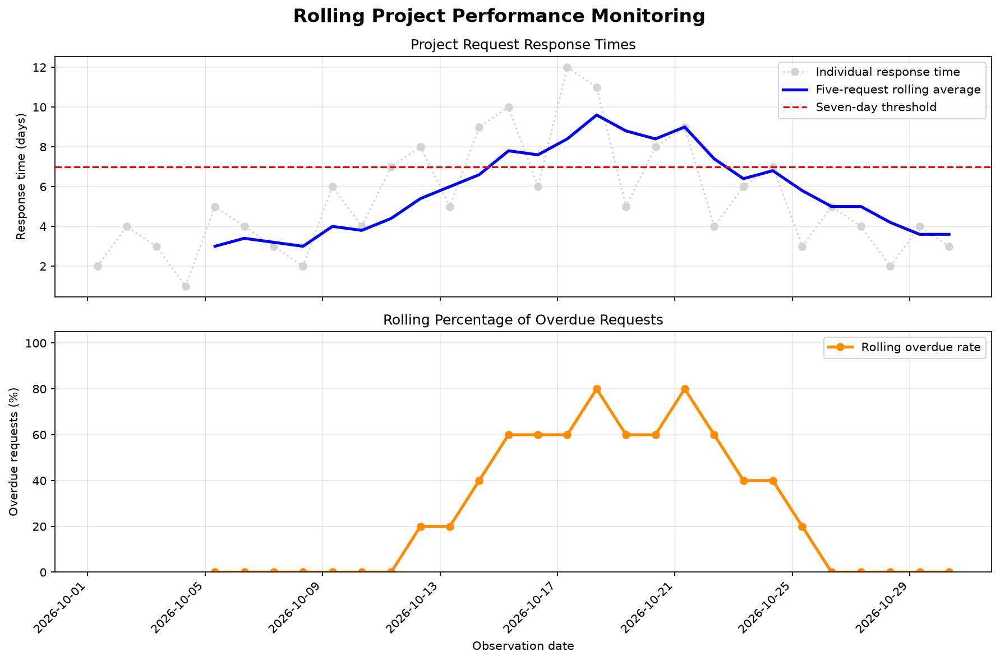

# Rolling Monitoring of Project Response Times

**Brian Cookson | Continuous Intelligence | Project 04 | Custom Application**

## Overview

This project explores how rolling-window analysis can help monitor
project request response times. Individual response times can
identify isolated delays, but they may not clearly reveal whether
overall performance is improving or deteriorating.

The goal is to determine whether rolling averages and overdue
percentages can reveal changing response-time patterns across
a chronological series of project requests.

## Data

The application uses a **synthetic dataset of 30 project requests**
recorded from October 1 through October 30, 2026.

Each observation includes:

- **Timestamp:** Date and time associated with the observation.
- **Request ID:** Unique identifier for each project request.
- **Project Phase:** Planning, Design, or Construction.
- **Response Days:** Number of days required to respond.

The dataset was created specifically for this educational project.
It does not contain actual employer records or production data.

Response times were designed to simulate increasing delays
followed by improved performance.

[View Custom Project Dataset](https://github.com/bcookson85/cintel-04-project-rolling/blob/main/data/project_responses_timeseries.csv)

## Methods and Tools

The application uses **Python, Polars, and Matplotlib** to process,
analyze, and visualize project response data.

The analysis follows these steps:

1. Load the CSV dataset using Polars.
2. Sort the observations chronologically by timestamp.
3. Flag requests with response times greater than seven days.
4. Calculate a five-observation rolling average of response times.
5. Calculate the percentage of overdue requests in each window.
6. Export the results to a CSV file.
7. Generate a chart showing response-time and overdue-rate trends.

Each completed rolling window includes the current request and
the four preceding requests. The first four observations do not
have rolling statistics because the full window is unavailable.

The calculations use all project requests in chronological order,
rather than calculating separate rolling averages for each phase.

The two main monitoring signals are:

- **Rolling Average Response Time:** Average response days for
  the most recent five project requests.
- **Rolling Overdue Rate:** Percentage of the most recent five
  requests with response times greater than seven days.

## Custom Application

Dr. Case's original example analyzes system metrics such as
request counts, errors, and latency.

My custom application applies similar rolling-window techniques
to a different problem: **monitoring project request responsiveness**.

The main differences include:

- A custom dataset containing 30 synthetic project requests.
- Project-specific identifiers and project phases.
- Response times measured in days instead of system latency.
- A five-observation rolling window.
- A seven-day overdue threshold.
- A calculated rolling overdue percentage.
- A visualization of response-time and overdue-rate trends.

This application also builds on my earlier coursework involving
project response times and overdue-request identification.

[View Custom Monitoring Application](https://github.com/bcookson85/cintel-04-project-rolling/blob/main/src/cintel/project_rolling.py)

[View Project Utility Functions](https://github.com/bcookson85/cintel-04-project-rolling/blob/main/src/cintel/utils_project.py)

[View Visualization Code](https://github.com/bcookson85/cintel-04-project-rolling/blob/main/src/cintel/visualize_project.py)

## Results and Visualization

The application successfully processed all 30 project requests
and generated rolling response-time and overdue-rate metrics.

*Figure 1. Individual response times, five-request rolling averages,
the seven-day threshold, and rolling overdue percentages.*

The results show several changes in project responsiveness.

| Observation | Rolling Average Response Time | Rolling Overdue Rate |
|---|---:|---:|
| October 5 | 3.0 days | 0% |
| October 15 | 7.8 days | 60% |
| October 18 | 9.6 days | 80% |
| October 21 | 9.0 days | 80% |
| October 30 | 3.6 days | 0% |

The rolling average increased during the middle of October,
reaching its highest value of **9.6 days on October 18**.

The rolling overdue percentage reached **80% on October 18
and October 21**, indicating that four of the five requests
in each window exceeded the seven-day threshold.

By October 30, the rolling average had decreased to **3.6 days**
and the rolling overdue percentage had returned to **0%**.

[View Generated Rolling Metrics](https://github.com/bcookson85/cintel-04-project-rolling/blob/main/artifacts/project_rolling_metrics.csv)

## Interpretation

The most important finding is that rolling-window analysis
makes developing response-time patterns easier to recognize.

Individual requests vary, but the five-request rolling average
shows a sustained increase in response times during the
middle of the observation period.

The rolling overdue percentage provides another perspective
by showing how frequently requests exceed a defined threshold.

Together, these indicators reveal a period of worsening
response performance followed by recovery.

In a real project environment, this approach could help
analysts identify response delays that warrant investigation.

Because the dataset is synthetic, these results demonstrate
the monitoring method rather than actual organizational performance.

## Limitations

This project has several limitations.

First, the dataset is synthetic and includes only 30 observations.
Actual project data would likely contain more variability.

Second, the seven-day overdue threshold is illustrative rather
than an established organizational requirement.

Third, rolling averages reduce short-term variation but may
delay recognition of sudden changes.

Fourth, the analysis combines Planning, Design, and Construction
requests into one chronological series. Separate calculations
might reveal important differences among project phases.

Finally, the analysis identifies changes in response-time
patterns but does not establish their causes.

## Next Steps

If I continued developing this project, I would:

- Apply the analysis to a larger, authorized project dataset.
- Compare rolling response times across project phases.
- Experiment with different rolling-window sizes.
- Add automated alerts for elevated response times.
- Create an interactive monitoring dashboard.

These improvements could help support project oversight
and identify emerging response delays.

## Conclusion

This project demonstrates how rolling monitoring techniques
introduced through system-metric analysis can be adapted
to a project management problem.

By combining rolling response-time averages with rolling
overdue percentages, the application provides a clearer
view of changing request responsiveness.

The experiment illustrates how continuous intelligence
techniques can transform chronological operational data
into interpretable monitoring signals.

## Documentation Index

- **Home** - This landing page
- [Project Instructions](project-instructions.md)
- [Glossary](glossary.md)
- [API](api.md)
- [Reactive App](./app/index.html)

## Project Links

- [GitHub Repository](https://github.com/bcookson85/cintel-04-project-rolling)
- [Custom Dataset](https://github.com/bcookson85/cintel-04-project-rolling/blob/main/data/project_responses_timeseries.csv)
- [Custom Monitoring Application](https://github.com/bcookson85/cintel-04-project-rolling/blob/main/src/cintel/project_rolling.py)
- [Generated Results](https://github.com/bcookson85/cintel-04-project-rolling/blob/main/artifacts/project_rolling_metrics.csv)
- [Original Rolling Monitoring Example](https://github.com/bcookson85/cintel-04-project-rolling/blob/main/src/cintel/rolling_monitor.py)

## Project Resources

- [Project Instructions](project-instructions.md)
- [Professional Python Guide](https://denisecase.github.io/pro-analytics-02/)
- [Professional Python Project Explainer](https://pup-pack.github.io/professional-python-project-explainer/)
- [Suggested Datasets](https://denisecase.github.io/pro-analytics-02/reference/datasets/cintel/)
